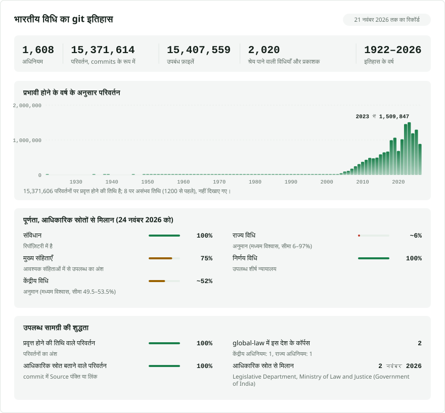

# भारत: git में विधि का इतिहास

[English](README.md) · **हिन्दी**

<picture>
<source media="(prefers-color-scheme: dark)" srcset="data/hi/effort-dark.svg">

</picture>

git इतिहास के रूप में भारत की विधि: हर धारा की एक फ़ाइल (संविधान में हर अनुच्छेद की), हर संस्करण का एक commit उसी दिन जिस दिन वह प्रभावी हुआ, और हर संस्करण बनाने वाली विधि commit की author। `git blame` हर पंक्ति के पीछे की विधि बताता है; `git log` किसी धारा के सभी परिवर्तन दिखाता है; कोई तिथि चुनने पर उस दिन प्रवृत्त पाठ मिलता है।

यह [lexifina/global-law](https://github.com/lexifina/global-law) का हिस्सा है, जो हर देश की विधि का एक git इतिहास है: यह भारत की राष्ट्रीय विधि है, जिसे global-law `india/national/acts/` पर पढ़ता है।

**अभी इसमें क्या है:** 22 नवंबर 2026 तक 2,153,798 commits। संविधान (1 मई 2024 का संस्करण) और 75 केंद्रीय अधिनियम उनकी धाराओं सहित, साथ ही 233 संशोधन अधिनियम और 20 अध्यादेश अधिनियमित रूप में। भारत के राजपत्र के 12,680 नियम, अधिसूचनाएँ और आदेश, 2022 से 2026 तक। राज्य विधि: महाराष्ट्र और गोवा के 217 अधिनियम, 335 संशोधन अधिनियम और 160 अध्यादेश, और 25 राज्यों तथा 5 केंद्रशासित प्रदेशों के राजपत्रों की 21,628 मदें। IBBI, IRDAI, PFRDA और TRAI के 1,547 परिपत्र, निर्देश, अधिसूचनाएँ और विनियम। उच्चतम न्यायालय के 35,262 निर्णय, 1950 से 2026 तक। सभी 25 उच्च न्यायालयों के 2,077,365 निर्णय और अंतिम आदेश, अभी तक अधिकतर 2024 से 2026 के। NCLAT के 4,233 आदेश, 2017 से 2021 तक।

**अभी रोके गए:**

- उच्च न्यायालयों के लगभग 400,000 अंतरिम आदेश (न्यायालयों के रिकॉर्ड में अंतिम के रूप में चिह्नित नहीं), जब तक यह तय न हो कि अंतरिम आदेश यहाँ रखे जाएँ या नहीं;
- भूमि अर्जन की लगभग 50,000 सूचनाएँ (भारत के राजपत्र में 23,198, राज्य राजपत्रों में 26,875), निर्णय होने तक;
- लगभग 240 केंद्रीय अधिनियम जो सरकार द्वारा अधिसूचित दिन से प्रवृत्त होते हैं, जब तक वह अधिसूचना न मिले (अब तक 45 की तिथि मिल चुकी है);
- लगभग 360 राज्य पुनर्मुद्रण जो किसी तिथि "तक यथासंशोधित" हैं, जब तक यह तय न हो कि वह तिथि किसी संस्करण की तिथि मानी जा सकती है;
- उच्च न्यायालयों की लगभग 235,000 PDF जिनकी text layer टूटी हुई है या है ही नहीं, और 7,000 जो अंग्रेज़ी में नहीं हैं, बाद के चरण के लिए।

यौन अपराध, POCSO, किशोर न्याय और वैवाहिक मामलों के निर्णय कभी शामिल नहीं किए जाते: वे छोड़ दिए जाते हैं, रोके नहीं जाते।

हर अधिनियम `central/acts/` के अंतर्गत एक folder है जिसका नाम उसके संक्षिप्त नाम और वर्ष पर है, जिसमें हर धारा की एक फ़ाइल, हर अध्याय के शीर्षक की एक फ़ाइल और उद्देशिका है (`central/acts/occupational-safety-health-and-working-conditions-code-2020/sec-032.md` उपजीविकाजन्य सुरक्षा, स्वास्थ्य और कार्यदशा संहिता, 2020 (2020 का अधिनियम 37) की धारा 32, मज़दूरी सहित वार्षिक छुट्टी, है); संविधान `constitution/art-001.md` से `art-395.md` तक है, जिसमें `art-021-a.md` जैसे अंतःस्थापित अनुच्छेद भी हैं। बाकी सब कुछ हर दस्तावेज़ की एक फ़ाइल है: भारत के राजपत्र की मदें `central/gazette/<yyyy>/<mm>/<dd>/` के अंतर्गत, राज्य विधि `states/<state>/` और `union-territories/<ut>/` के अंतर्गत, विनियामक `regulators/<name>/` के अंतर्गत, निर्णय `courts/supreme-court/<yyyy>/<mm>/` और `courts/high-courts/<court>/<bench>/<yyyy>/<mm>/<dd>/` के अंतर्गत, और NCLAT के आदेश `tribunals/nclat/<bench>/<yyyy>/<mm>/` के अंतर्गत।

पाठ अंग्रेज़ी में है, वही आधिकारिक अंग्रेज़ी पाठ जो भारत का राजपत्र और विधायी विभाग छापते हैं। हिन्दी पाठ इस रिकॉर्ड का हिस्सा नहीं है।

## git कमांड के रूप में प्रश्न

| प्रश्न | कमांड |
| --- | --- |
| OSH संहिता की धारा 32 का हर परिवर्तन | `git log -p --follow --word-diff -- central/acts/occupational-safety-health-and-working-conditions-code-2020/sec-032.md` |
| धारा 32 की हर पंक्ति किस विधि ने लिखी? | `git blame central/acts/occupational-safety-health-and-working-conditions-code-2020/sec-032.md` |
| OSH संहिता का हर संस्करण, हर एक के प्रभावी होने के दिन सहित | `git log --format="%h %(trailers:key=In-force,valueonly,separator=) %an" -- central/acts/occupational-safety-health-and-working-conditions-code-2020 occupational-safety-health-and-working-conditions-code ':!*/README.md'` |
| 1 जनवरी 2026 को प्रवृत्त धारा 32 | `python tools/on.py 2026-01-01 central/acts/occupational-safety-health-and-working-conditions-code-2020 32` |

**git के बाहर** भी, हम यह रिकॉर्ड सार्वजनिक रूप से, निःशुल्क उपलब्ध कराते हैं:

- **[भारतीय विधि के बारे में Claude से पूछें](https://global-law.lexifina.com/v1/try_claude?country=india)**: पहले प्रश्न के साथ Claude खोलता है।
- **[ChatGPT से पूछें](https://global-law.lexifina.com/v1/try_chatgpt?country=india)**: वही प्रश्न ChatGPT में।
- **[हमारी साइट पर भारतीय विधि खोजें](https://lexifina.com/law?country=india&q=annual+leave)**: "annual leave" की खोज, हर उपबंध के पाठ और उसके संस्करणों के साथ, बिना खाते के।
- **[डेवलपर REST API](https://global-law.lexifina.com/v1/search_law?query=annual+leave&jurisdiction=india)**: वही खोज JSON में, बिना key के। [दस्तावेज़ यहाँ](https://lexifina.com/api/global-law) देखें।

दोनों सहायक निःशुल्क Global law connector (MCP, `https://global-law.lexifina.com/mcp`) से रिकॉर्ड पढ़ते हैं; पहली बार, चैट आपको उसे जोड़ने का लिंक देती है। अंग्रेज़ी में पूछें।

**इसे आसानी से स्वयं host करें।** बस git और Python चाहिए, और tools आपकी मशीन पर चलते हैं:

```sh
git clone --depth 1 https://github.com/lexifina/global-law && cd global-law
python3 tools/countries.py add india/national/acts
python3 tools/law.py show 2026-01-01 india/national/acts/central/acts/occupational-safety-health-and-working-conditions-code-2020/sec-032.md
```

Claude Code, Cursor, VS Code या Codex में खोलने पर, clone उन्हीं tools वाला एक स्थानीय MCP server भी शुरू करता है ([MCP.md](https://github.com/lexifina/global-law/blob/main/MCP.md))।

## तिथियाँ

हर commit की तिथि उस दिन दोपहर 12 बजे (Asia/Kolkata) की है जिस दिन संस्करण प्रभावी हुआ, और वह दिन उसके `In-force:` trailer में होता है:

- अधिनियम के लिए, वह दिन जो उसकी प्रारंभ अधिसूचना या उसका अपना प्रारंभ खंड देता है: 2023 की तीनों संहिताओं के लिए 1 जुलाई 2024, तीन श्रम संहिताओं के लिए 21 नवंबर 2025, आय-कर अधिनियम के लिए 1 अप्रैल 2026;
- चरणों में प्रवृत्त किए गए अधिनियम के लिए, उसका पहला प्रारंभ: कंपनी अधिनियम के लिए 30 अगस्त 2013 (धारा 1), और मज़दूरी संहिता के लिए 18 दिसंबर 2020, साथ में 21 नवंबर 2025 की अधिसूचना S.O. 5322(E) का दूसरा commit, जिसने एक भी शब्द बदले बिना और उपबंध प्रवृत्त किए (`Words-changed: no`);
- संविधान के लिए, विधायी विभाग के संस्करण का दिन, 1 मई 2024, न कि 26 जनवरी 1950;
- निर्णय या आदेश के लिए, वह दिन जिस दिन वह दिया गया; राजपत्र की मद के लिए, उसके प्रकाशन का दिन, जब तक वह कोई और प्रारंभ दिन न बताए।

हर अधिनियम के संस्करण का श्रेय स्वयं अधिनियम को है (`Act 37 of 2020`), और मज़दूरी संहिता के दूसरे commit का अधिसूचना को। संविधान का एकमात्र संस्करण उपलब्ध सबसे पुराना संस्करण है, जिसका श्रेय उसके प्रकाशक, विधायी विभाग, विधि और न्याय मंत्रालय को है। निर्णयों का श्रेय उनके न्यायालय को है, और राजपत्र की मदों का उन्हें जारी करने वाले मंत्रालय या निकाय को।

## इसकी जाँच कैसे होती है

- `tools/check_repo.py` हर अधिनियम को git से उस दिन और उससे पहले के दिन पढ़ता है जिस दिन हर संस्करण प्रभावी हुआ, और उसकी तुलना उस corpus से करता है जिससे इतिहास बना; परिणाम [`REPRODUCE.md`](REPRODUCE.md) में है।
- `tools/verify_parts.py` और `tools/verify_window.py` हर अधिनियम की पंक्ति-दर-पंक्ति जाँच उसकी राजपत्र PDF की text layer से करते हैं (केवल अक्षर और अंक, हर पंक्ति अपनी ही धारा के भीतर)।
- इतिहास केवल आगे जुड़ता है: कोई merge commit नहीं, committer की तिथियाँ कभी पीछे नहीं जातीं, build के बाद की कोई तिथि नहीं, और हर commit के trailers पार्स होते हैं।
- एक ही corpus से हमेशा वही commit hashes बनते हैं; अभी तक दूसरे build से तुलना नहीं हुई है।
- [vulnerabilities/](vulnerabilities/): इस विधि में संभावित प्रारूपण त्रुटियाँ, global-law के detectors द्वारा पाई गईं और हाथ से जाँची गईं। अभी चलाया नहीं गया।

## यह क्या नहीं दिखाता

- **संशोधन।** हर अधिनियम अपने अधिनियमित पाठ में है, और संविधान एक समेकित संस्करण में; संशोधन दोबारा लागू नहीं किए गए हैं (संविधान के 106, या आय-कर अधिनियम में किसी वित्त अधिनियम के परिवर्तन)।
- **चरणबद्ध प्रारंभ।** कंपनी अधिनियम, 2013 और सामाजिक सुरक्षा संहिता, 2020 चरणों में प्रवृत्त हुए; यहाँ हर अधिनियम एक ही दिन रखता है।
- **अनुसूचियाँ और पार्श्व शीर्ष।** अनुसूचियाँ, धाराओं के पार्श्व शीर्ष, संविधान के परिशिष्ट और उसके संशोधन संबंधी फ़ुटनोट छोड़ दिए गए हैं; आय-कर अधिनियम की तालिकाएँ सपाट कर दी गई हैं, हर पंक्ति में एक cell।
- **अभी तक भारत की अधिकांश विधि।** लगभग दस में से नौ केंद्रीय अधिनियम, 2022 से पहले की भारत के राजपत्र की मदें, महाराष्ट्र और गोवा को छोड़कर हर राज्य के अधिनियम, 2024 से पहले के उच्च न्यायालयों के अधिकतर निर्णय (वह चरण सबसे नए वर्ष से पीछे की ओर चलता है), और अधीनस्थ न्यायालय तथा अधिकतर अधिकरण अभी यहाँ नहीं हैं।

## स्रोत

| स्रोत | प्रकार | पिछले संस्करण | टिप्पणी |
| --- | --- | --- | --- |
| [e-Gazette](https://egazette.gov.in) (भारत का राजपत्र) | आधिकारिक राजपत्र | नहीं, हर अधिनियम अधिनियमित रूप में | अधिनियमित रूप में अधिनियम और अध्यादेश, प्रारंभ अधिसूचनाएँ, और भारत के राजपत्र के नियम, अधिसूचनाएँ और आदेश |
| [विधायी विभाग](https://legislative.gov.in/constitution-of-india/) (विधि और न्याय मंत्रालय) | आधिकारिक समेकित पाठ | नहीं, 1 मई 2024 का संस्करण | भारत का संविधान, उद्देशिका और अनुच्छेद 1 से 395 |
| [Internet Archive](https://archive.org/details/gazetteofindia) (gazetteofindia और राज्य राजपत्रों के संग्रह) | आधिकारिक राजपत्र PDF की प्रतियाँ | नहीं, हर मद प्रकाशित रूप में | अधिकतर अधिनियम और भारत के राजपत्र की मदें, और राज्य राजपत्रों की मदें; हर commit आधिकारिक फ़ाइल का नाम भी देता है |
| [AWS Open Data](https://registry.opendata.aws/indian-supreme-court-judgments/) (Indian Supreme Court और [High Court](https://registry.opendata.aws/indian-high-court-judgments/) Judgments, Dattam Labs, CC BY 4.0) | निर्णय, न्यायालयों के पोर्टलों से एकत्र | नहीं, हर निर्णय जैसा दिया गया | उच्चतम न्यायालय और उच्च न्यायालयों के निर्णय |
| [विधि और न्याय विभाग, महाराष्ट्र](https://old-lj.maharashtra.gov.in) और [गोवा सरकार](https://www.goa.gov.in/government/acts-and-rules/) | आधिकारिक पुनर्मुद्रण और अधिनियम | नहीं, वर्तमान पुनर्मुद्रण या अधिनियमित रूप में अधिनियम | महाराष्ट्र और गोवा के अधिनियम और अध्यादेश |
| [IBBI](https://ibbi.gov.in), [IRDAI](https://irdai.gov.in), [PFRDA](https://www.pfrda.org.in), [TRAI](https://www.trai.gov.in) | विनियामकों की अपनी साइटें | नहीं | परिपत्र, निर्देश, अधिसूचनाएँ और विनियम |
| [NCLAT](https://nclat.nic.in/judgement-data) | अधिकरण की अपनी साइट | नहीं | 31 मई 2021 से पहले के NCLAT आदेश |

## अनुज्ञप्ति

[`LICENSE`](LICENSE) देखें। प्रतिलिप्यधिकार अधिनियम, 1957 की धारा 52(1)(q) राजपत्र की सामग्री, और निर्णयों तथा आदेशों, के पुनरुत्पादन की अनुमति देती है, और विधान-मंडल के किसी अधिनियम के, टीका या अन्य मूल सामग्री के साथ, जो यहाँ commit रिकॉर्ड, संस्करण-वार टिप्पणियाँ, तालिकाएँ और tools हैं; उच्चतम न्यायालय और उच्च न्यायालयों के निर्णय AWS Open Data पर Dattam Labs के datasets से CC BY 4.0 के अधीन लिए गए हैं; संविधान भारत सरकार द्वारा सार्वजनिक उपयोग के लिए प्रकाशित है, और यह रिपॉज़िटरी उस पर कोई दावा नहीं करती। Lexifina का अपना कार्य (commits, टिप्पणियाँ, तालिकाएँ, tools और READMEs) CC0 1.0 के अधीन सार्वजनिक क्षेत्र को समर्पित है; [`LICENSE`](LICENSE) हर स्रोत की अपनी शर्तें बताती है।

किसी AI मॉडल ने विधिक पाठ नहीं लिखा, अनूदित किया या सुधारा, और इतिहास बनाते समय कोई AI मॉडल नहीं चलता; scripts एक AI मॉडल ने लिखी थीं ([`REPRODUCE.md`](REPRODUCE.md) देखें)।

यह पृष्ठ अंग्रेज़ी [README.md](README.md) का अनुवाद है; किसी अंतर की स्थिति में अंग्रेज़ी संस्करण मान्य है।

## विज़ुअलाइज़ेशन

- [visualisations/](visualisations/): इस रिपॉज़िटरी से बनाए गए चार्ट। अभी नहीं बनाए गए।

## और जानकारी

[lexifina/global-law](https://github.com/lexifina/global-law) से (अंग्रेज़ी पृष्ठ):

- [FEATURES.md](https://github.com/lexifina/global-law/blob/main/FEATURES.md): हर सुविधा, और हर corpus को क्या समर्थित करना चाहिए (`git blame`, `law.py`, MCP tools)
- [FAQ.md](https://github.com/lexifina/global-law/blob/main/FAQ.md): प्रश्न और उत्तर · [CONTRIBUTING.md](https://github.com/lexifina/global-law/blob/main/CONTRIBUTING.md): परिवर्तन प्रस्तावित करना · [MCP.md](https://github.com/lexifina/global-law/blob/main/MCP.md): MCP server · [REPRODUCE.md](https://github.com/lexifina/global-law/blob/main/REPRODUCE.md): यह कैसे बनाया गया · [CHANGELOG.md](https://github.com/lexifina/global-law/blob/main/CHANGELOG.md)
- [FRESHNESS.md](https://github.com/lexifina/global-law/blob/main/FRESHNESS.md): हर corpus कितना अद्यतन है · [निगरानी](https://github.com/lexifina/global-law/tree/main/monitoring): अद्यतन चल रहे हैं या नहीं · [WATCHING.md](https://github.com/lexifina/global-law/blob/main/WATCHING.md): हर आधिकारिक स्रोत में परिवर्तनों पर नज़र कैसे रखी जाती है
- [performance/](https://github.com/lexifina/global-law/tree/main/performance): tools कितने तेज़ हैं, मापकर
- [visualisations/](https://github.com/lexifina/global-law/tree/main/visualisations): दुनिया की विधि के आर-पार चार्ट और संबंध
- [Vulnerabilities](https://github.com/lexifina/global-law/tree/main/vulnerabilities): प्रकाशित विधान में त्रुटियाँ
