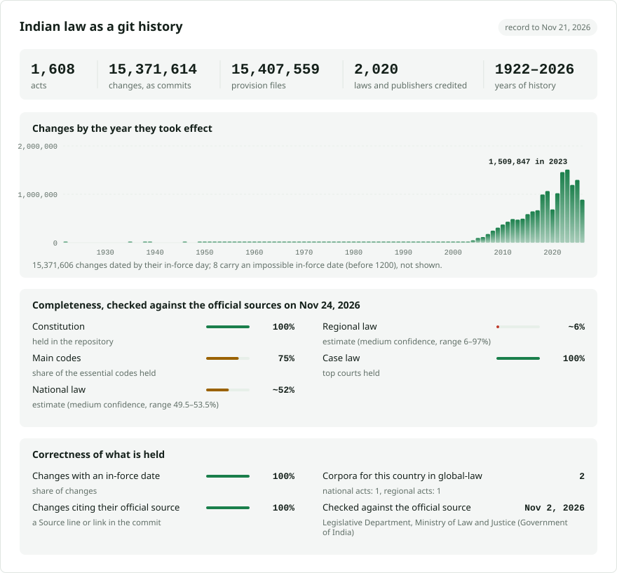

# India: law history in git

<picture>
<source media="(prefers-color-scheme: dark)" srcset="data/effort-dark.svg">

</picture>

The law of India as a git history: one file per section (per article for the Constitution), one commit per version on the day it took effect, and the law that made each version as the commit's author. `git blame` names the law behind every line; `git log` lists every change to a section; picking a date gives the text in force that day.

Part of [lexifina/global-law](https://github.com/lexifina/global-law), one git history for every country's law: this is India's national law, which global-law reads at `india/national/acts/`.

**What is in it now:** the Constitution and 9 Acts of Parliament, with 11 versions: the Constitution as on 1 May 2024; the Bharatiya Nyaya Sanhita, the Bharatiya Nagarik Suraksha Sanhita and the Bharatiya Sakshya Adhiniyam, 2023 (the criminal, criminal procedure and evidence codes); the four labour codes of 2019 and 2020; the Companies Act, 2013; and the Income-tax Act, 2025. [`data/commits.csv`](data/commits.csv) lists every version with its day and law; each act's folder has a `README.md` listing its provisions.

Each act is a folder named after it, with one file per section, a file per chapter title and the preamble (`occupational-safety-health-and-working-conditions-code/sec-032.md` is section 32, annual leave with wages, of the Occupational Safety, Health and Working Conditions Code, 2020, Act 37 of 2020); the Constitution is `constitution/art-001.md` to `art-395.md`, with inserted articles such as `art-021-a.md`.

The text is in English, the official English text as the Gazette of India and the Legislative Department print it. The Hindi text is not part of this record.

## Questions as git commands

| Question | Command |
| --- | --- |
| Every change to section 32 of the OSH Code | `git log -p --word-diff -- occupational-safety-health-and-working-conditions-code/sec-032.md` |
| Which law wrote each line of section 32? | `git blame occupational-safety-health-and-working-conditions-code/sec-032.md` |
| Every version of the OSH Code, with the day each took effect | `git log --format="%h %(trailers:key=In-force,valueonly,separator=) %an" -- occupational-safety-health-and-working-conditions-code ':!*/README.md'` |
| Section 32 as in force on 1 January 2026 | `python tools/on.py 2026-01-01 occupational-safety-health-and-working-conditions-code 32` |

**Outside git**, we also host this record publicly, for free:

- **[Ask Claude about Indian law](https://global-law.lexifina.com/v1/try_claude?country=india)**: opens Claude with a first question ready.
- **[Ask ChatGPT](https://global-law.lexifina.com/v1/try_chatgpt?country=india)**: the same question in ChatGPT.
- **[Search Indian law on our site](https://lexifina.com/law?country=india&q=annual+leave)**: a search for "annual leave", with each provision's text and its versions, no account needed.
- **[Developer REST API](https://global-law.lexifina.com/v1/search_law?query=annual+leave&jurisdiction=india)**: the same search as JSON, with no key. See the [documentation here](https://lexifina.com/api/global-law).

Both assistants read the record through the free Global law connector (MCP, `https://global-law.lexifina.com/mcp`); the first time, the chat gives you the link that adds it. Ask in English.

**Host it yourself easily.** All it takes is git and Python, and the tools run on your machine:

```sh
git clone --depth 1 https://github.com/lexifina/global-law && cd global-law
python3 tools/countries.py add india/national/acts
python3 tools/law.py show 2026-01-01 india/national/acts/occupational-safety-health-and-working-conditions-code/sec-032.md
```

Opened in Claude Code, Cursor, VS Code or Codex, the clone also starts a local MCP server with the same tools ([MCP.md](https://github.com/lexifina/global-law/blob/main/MCP.md)).

## Dates

Each commit is dated at noon, Asia/Kolkata, on the day the version took effect, and carries it in its `In-force:` trailer:

- for an Act, the day its commencement notification or its own commencement clause gives: 1 July 2024 for the three 2023 codes, 21 November 2025 for three of the labour codes, 1 April 2026 for the Income-tax Act;
- for an Act brought into force in stages, its first commencement: 30 August 2013 (section 1) for the Companies Act, and 18 December 2020 for the Code on Wages, with a second commit for notification S.O. 5322(E) of 21 November 2025, which commenced further provisions without changing a word (`Words-changed: no`);
- for the Constitution, the day of the Legislative Department's edition, 1 May 2024, not 26 January 1950.

Each Act's version is credited to the Act itself (`Act 37 of 2020`), and the Code on Wages' second commit to the notification. The Constitution's one version is the oldest version available, credited to its publisher, the Legislative Department, Ministry of Law and Justice.

## How it is checked

- `tools/check_repo.py` reads every act back from git on the day each version took effect and on the day before, and compares it with the corpus the history was built from; the result is in [`REPRODUCE.md`](REPRODUCE.md).
- `tools/verify_parts.py` and `tools/verify_window.py` check each act line by line against the text layer of its Gazette PDF (letters and digits only, each line within its own section).
- History is append-only: no merge commits, committer dates never go backwards, nothing is dated after the build, and every commit's trailers parse.
- The same corpus always gives the same commit hashes; no second build has been compared yet.
- [vulnerabilities/](vulnerabilities/): possible drafting mistakes in this law, found by global-law's detectors and checked by hand. Not run yet.

## What it does not show

- **Amendments.** Each Act is its text as enacted, and the Constitution one consolidated edition; amendments are not replayed (the Constitution's 106, or any Finance Act changes to the Income-tax Act).
- **Staged commencement.** The Companies Act, 2013 and the Code on Social Security, 2020 commenced in stages; each Act here carries one day.
- **Schedules and margins.** The Schedules, the marginal section headings, the Constitution's Appendices and its amendment footnotes are left out; tables in the Income-tax Act are flattened, one cell per line.
- **Most of India's law.** Other Acts of Parliament, rules and notifications, State law and case law are not here.

## Sources

| Source | Kind | Past versions | Notes |
| --- | --- | --- | --- |
| [e-Gazette](https://egazette.gov.in) (Gazette of India, Extraordinary, Part II, Section 1) | Official Gazette | no, each Act as enacted | The nine Acts, and the labour codes' commencement notifications (Part II, Section 3(ii)) |
| [Legislative Department](https://legislative.gov.in/constitution-of-india/) (Ministry of Law and Justice) | Official consolidated text | no, the edition as on 1 May 2024 | The Constitution of India, Preamble and Articles 1 to 395 |

## Licence

See [`LICENSE`](LICENSE). Section 52(1)(q) of the Copyright Act, 1957 allows an Act of a Legislature to be reproduced together with commentary or other original matter, here the commit records, per-version notes, tables and tools; the Constitution is published by the Government of India for public use, and this repository makes no claim over it.

No AI model wrote, translated or corrected legal text, and none runs when the history is built; the scripts were written by an AI model (see [`REPRODUCE.md`](REPRODUCE.md)).

## Visualisations

- [visualisations/](visualisations/): charts drawn from this repository. Not drawn yet.

## More

From [lexifina/global-law](https://github.com/lexifina/global-law):

- [FEATURES.md](https://github.com/lexifina/global-law/blob/main/FEATURES.md): every feature, and what every corpus must support (`git blame`, `law.py`, the MCP tools)
- [FAQ.md](https://github.com/lexifina/global-law/blob/main/FAQ.md): questions and answers · [CONTRIBUTING.md](https://github.com/lexifina/global-law/blob/main/CONTRIBUTING.md): proposing changes · [MCP.md](https://github.com/lexifina/global-law/blob/main/MCP.md): the MCP server · [REPRODUCE.md](https://github.com/lexifina/global-law/blob/main/REPRODUCE.md): how it was built · [CHANGELOG.md](https://github.com/lexifina/global-law/blob/main/CHANGELOG.md)
- [FRESHNESS.md](https://github.com/lexifina/global-law/blob/main/FRESHNESS.md): how current each corpus is · [Monitoring](https://github.com/lexifina/global-law/tree/main/monitoring): whether updates are running · [WATCHING.md](https://github.com/lexifina/global-law/blob/main/WATCHING.md): how each official source is watched for changes
- [performance/](https://github.com/lexifina/global-law/tree/main/performance): how fast the tools are, measured
- [visualisations/](https://github.com/lexifina/global-law/tree/main/visualisations): charts and bridges across the world's law
- [Vulnerabilities](https://github.com/lexifina/global-law/tree/main/vulnerabilities): mistakes in legislation as published
